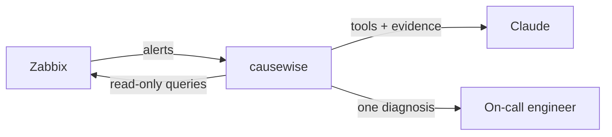

# causewise

**When Zabbix fires thirty alerts at 3 a.m., causewise tells you which one is the cause.**

A self-hosted, read-only investigator for Zabbix. It looks into each incident
the way an on-call engineer would and reports the likely cause with the
evidence, instead of leaving you with a pile of alerts.

[](https://github.com/zishon89us/causewise/actions/workflows/ci.yml)
[](LICENSE)


> **Status: pre-release.** Receiving alerts, forming incidents and
> investigating them are built. Sending the diagnosis to chat is not, and the
> investigator has not yet been measured against the live Claude API. See
> [Where it stands](#where-it-stands).

## The problem

One failure causes many alerts. When a storage device slows down:

- the database on it gets slow, and alerts
- the four applications using that database get slow, and each alerts
- the four web servers in front of them get slow, and each alerts
- the storage device itself may not alert at all, because it is slow but
  still under its alarm threshold

The engineer's phone shows nine alerts and none of them names the real cause.
They spend the next 15 to 45 minutes opening graphs host by host while
customers are affected.

## What causewise does

It sits beside Zabbix. When alerts start, it checks the metrics, compares when
each thing started going wrong, and looks at what the affected hosts have in
common. Then it produces one diagnosis. The message it is designed to send
looks like this:

> **Likely cause: nas-01 (storage).** Latency rose from 4 ms to 120 ms at
> 03:02, one minute before the database slowed down. The database, apps and
> web servers are symptoms.
> **Ruled out:** network, database CPU and memory.
> **Confidence:** high. **Next step:** check the storage array.

The engineer starts from an answer they can verify, not from a list.



## Why it is safe to install

- **It can only read.** The code refuses any Zabbix call outside six read
  methods, and the install guide sets up a Zabbix role limited to the same
  six. It cannot change, restart or acknowledge anything.
- **It runs in your network.** One container next to Zabbix, with outbound
  connections only.
- **It says "I don't know".** When the monitoring data does not show a cause,
  the diagnosis says so and lists what was ruled out. A confident wrong
  answer at 3 a.m. is worse than none.
- **Every claim is traceable.** Each piece of evidence cites the query that
  produced it, and every query is stored.

One thing to know before installing: each investigation sends alert names,
host names, tags and metric values to the Claude API. Masking of host names
is planned and not built.

## How it compares

| | What it does with a burst of alerts |
| --- | --- |
| Zabbix 7.0 | Sends them all |
| Zabbix 8.0 grouping rules | Labels the first alert in a time window as the cause |
| Enterprise AIOps suites | Correlate and diagnose, at enterprise prices |
| **causewise** | Investigates with read-only queries and explains the cause, self-hosted |

## Does it work?

Measured on simulated outages with a known cause, replayed into a real Zabbix:

| Approach | First set (10 outages) | Harder set (14 outages) |
| --- | --- | --- |
| Zabbix 8.0, first alert in the window is the cause | 5 of 10 | not run |
| AI model shown only the alert list | 9 of 10 | 4 of 14 |
| AI model investigating with causewise's read-only tools | 10 of 10 | 13 of 14 |

The harder set is made of cases where reading alerts is not enough: a cause
below its alarm threshold, a host that silently stops reporting, a cause that
has already recovered, two faults at once.

Read these numbers with their limits:

- One run per outage, on Claude Sonnet 5.5, through an evaluation harness
  and not through the shipped service. The first measurement of the service
  itself against the live API is the next step.
- The scenarios were written by the same AI agent family that was tested, on
  a 19-host simulated estate. Real estates are larger and messier.
- Nobody outside the project has reviewed the scenarios or the scores.

Method, raw answers and scoring: [`docs/m0-results.md`](docs/m0-results.md),
[`docs/ai/eval-plan.md`](docs/ai/eval-plan.md), [`evals/`](evals/).

## Where it stands

| Part | State |
| --- | --- |
| Receive Zabbix alerts by webhook (7.0 and 8.0) | Built, tested end to end against both versions |
| Group alerts into one incident | Built |
| Read-only Zabbix access and investigation tools | Built, tested against both versions |
| Investigator on Claude | Built; tested against a mock of the API only |
| Automatic scoring of diagnoses | Built |
| Diagnosis delivered to Telegram or Slack | Not built |
| Host-name masking, daily spend limit | Not built |
| Used on a real Zabbix installation | Not yet |

Detailed progress: [`docs/STATUS.md`](docs/STATUS.md).

## Try it

Install beside a Zabbix 7.0 or 8.0 server: [`docs/install.md`](docs/install.md).

Or run the lab, which starts both Zabbix versions with a simulated estate.
Needs Docker and Node.js 22.18 or newer.

```bash
npm ci
```

```bash
docker compose -f lab/docker-compose.yml up -d
```

```bash
node sim/provision.mjs 7.0
```

```bash
node sim/replay.mjs 7.0
```

Look at a replayed outage with the same tools the investigator uses, taking
a `page_at` value from `evals/golden/incidents.7.0.local.json`:

```bash
node tools/zq.mjs --lab 7.0 --at <page_at> problems
```

Run the investigator on all 24 replayed outages. This calls the Claude API
and costs money; the cap stops it at the amount you set.

```bash
ANTHROPIC_API_KEY=... npm run eval -- --max-usd 5
```

The lab uses Zabbix's default throwaway credentials and binds to localhost
only. Do not expose it.

## Develop

```bash
npm run check
```

That runs the type check and the unit tests. Two more checks need the lab
running:

```bash
npm run e2e:lab
```

```bash
npm run e2e:tools
```

## What is in the repository

| Path | What it is |
| --- | --- |
| `src/`, `test/` | The service: webhook receiver, incident former, store, read-only Zabbix client, investigation tools, investigator loop, Claude adapter, scorers |
| `prompts/` | Versioned prompts |
| `zabbix/` | Webhook script and importable media types for Zabbix 7.0 and 8.0 |
| `lab/` | Docker Compose lab with Zabbix 7.0 LTS and 8.0 LTS side by side |
| `sim/` | Simulated estate, twenty outage scenarios with a known cause, and the 24-incident dataset |
| `evals/` | Eval runner, scorer front end, recorded answers and scores |
| `e2e/` | End-to-end checks against the lab |
| `docs/` | Requirements, design, decision records, eval plan, results, install guide |
| `AGENTS.md` | Working agreement for the AI agent that builds this |

## How this project is built

An AI coding agent (Claude) writes the code, tests and documents under the
direction of a human maintainer, who sets the scope, makes the decisions and
reviews and merges every change. The rules the agent works under are in
[`AGENTS.md`](AGENTS.md). One of them: every accuracy claim in this
repository comes from a run whose data is in the repository, reported next
to its baseline and its limits.

## Licence

[MIT](LICENSE)
