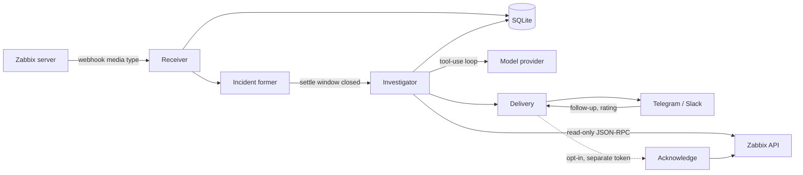

# Architecture

Status: draft for maintainer review · M1

One process, one container, inside the operator's network.

## Components

| Component | Responsibility |
| --- | --- |
| Receiver | Authenticates the webhook (shared secret), validates the payload, stores the raw alert, returns at once |
| Incident former | Groups alerts into an incident and decides when to investigate (ADR 0005) |
| Zabbix client | The only code that talks to Zabbix. Read-only allow-list of API methods. Rate-limited |
| Investigator | Agent loop: the model calls a fixed set of read-only tools within a budget and returns a diagnosis (ADR 0006) |
| Masker | Replaces hostnames and IP addresses with stable placeholders on the way to the model and restores them on the way back |
| Delivery | Formats and sends the diagnosis; handles follow-ups and ratings; retries |
| Acknowledge | Separate module with its own token; absent unless configured |
| Store | Alerts, incidents, diagnoses, every query run, ratings, budgets |

## Investigation tools

The tools proven in M0 (`tools/zq.mjs`) become the investigator's tool set:

| Tool | Returns |
| --- | --- |
| `problems` | Open problems, with start time, severity, host, name |
| `events(minutes)` | Problem and recovery events in a window |
| `hosts` | Hosts with tags and groups |
| `items(host)` | Every metric on a host, latest value and its age |
| `history(host, key, minutes)` | Samples of one metric |

`triggers(host)` (alert rules and their thresholds) and `maintenance`
were added in M3; the tools live in `src/tools.ts`.

Still to add, each with an eval case that needs it: host dependencies and
maps, and on 8.0 the native cause and symptom links. Recent configuration
changes are not available: the audit log needs a super admin (ADR 0003).

## What M0 and the M1 pilot taught the design

- **Show data age.** Twice the model drew a wrong inference from a metric
  sampled every five minutes. Tool output must show each value's age and the
  item's interval, and the prompt must say how to treat stale values.
- **Missing data is evidence.** A host that stops reporting is a finding;
  `items` must make "no data since" obvious.
- **Resolved events matter.** The cause may already have recovered; the
  investigation always reads the event history, not only open problems.
- **Do not trust arrival order.** Which alert fires first depends on check
  timing.
